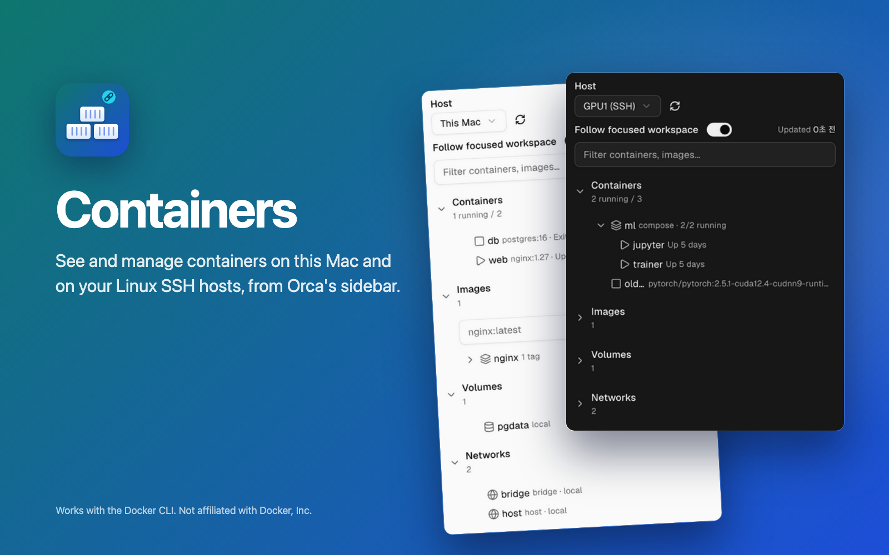

# Containers for Orca



[Orca](https://github.com/stablyai/orca) 사이드바 패널에서 Docker 컨테이너를 보고 관리합니다. 이 Mac과
Linux·macOS SSH 호스트 모두 지원합니다. 호스트를 고르면 컨테이너, 이미지, 볼륨, 네트워크를 볼 수 있습니다. 컨테이너는
시작, 중지, 재시작하거나 로그를 보고 셸을 열고 삭제할 수 있습니다. Compose 프로젝트는 시작, 중지, 재시작하거나
Up, Down을 실행할 수 있습니다. 이미지, 볼륨, 네트워크는 삭제할 수 있고, 이미지는 Orca 터미널에서 pull할 수 있습니다.

[English](README.md)

## 기능

- **호스트 선택:** 이 Mac과 Orca에 등록된 SSH 호스트.
- **포커스된 워크스페이스 따라가기:** 기본값은 켜짐입니다. 포커스된 워크스페이스가 호스트 하나로
  특정될 때만 호스트를 바꿉니다.
- **필터:** 입력한 글자가 들어간 항목만 섹션마다 보여 줍니다. 대소문자는 가리지 않습니다.
- **접는 섹션:** Containers, Images, Volumes, Networks로 나뉘고, 섹션마다 개수가 표시됩니다(Containers는
  실행 중인 수도 함께). 처음에는 Containers만 펼쳐져 있고, 어떤 섹션을 펼쳤는지는 패널이 기억합니다.
- **Compose 프로젝트별 묶음:** 같은 Compose 프로젝트의 컨테이너는 그 프로젝트 아래에 모이고, 나머지
  컨테이너는 그 뒤에 나옵니다. Compose 프로젝트 안의 컨테이너는 상태 아이콘, 서비스 이름, 상태가 보이고, 그 밖의 컨테이너는
  이미지와 상태가 보입니다.
- **컨테이너 상세와 동작:** 컨테이너를 선택하면 전체 이름, 이미지, 상태, 포트, Compose 프로젝트, ID가 담긴 카드가
  나오고, 그 카드에서 Start, Stop, Restart, Logs, Shell, Delete를 쓸 수 있습니다. Delete는 확인을 거치고,
  실행 중인 컨테이너에는 비활성화됩니다. 컨테이너에서 Enter를 누르거나 더블클릭하면 로그가 열립니다. Shell은 해당 호스트에 터미널을 열고, Orca가 그
  터미널을 앞으로 가져오려고 시도합니다. Compose 프로젝트 행을 클릭하면 접히거나 펼쳐지고, 프로젝트 카드가 나옵니다([Compose 프로젝트](#compose-프로젝트) 참고).
- **이미지, 볼륨, 네트워크:** 이미지 태그, 볼륨, 네트워크를 선택하면 상세 정보와 Delete 버튼이 담긴 카드가 나오고,
  Delete는 확인을 거칩니다. 강제 삭제는 하지 않으므로, 사용 중인 항목(예: 컨테이너가 쓰는 볼륨, 컨테이너가 연결된
  네트워크)은 Docker가 삭제를 거부하고 카드에 Docker의 메시지가 표시됩니다. 이미지 태그는 이름으로 삭제하고(다른
  태그가 쓰지 않으면 Docker가 이미지도 지움), 저장소나 태그가 없는 이미지는 ID로 삭제합니다. 기본 네트워크
  `bridge`, `host`, `none`은 삭제할 수 없습니다. Images의 저장소 행을 클릭하면 접히거나 펼쳐집니다.
- **이미지 pull:** 이미지 태그 카드의 **Pull**이나 Images 섹션에 입력한 이름(예: `nginx:latest`)으로, 해당 호스트의
  Orca 터미널에서 `docker pull`을 실행합니다. Shell과 같은 방식이라 큰 이미지도 패널 요청 시간 제한을 받지
  않습니다. 이미지 참조 형식이 아닌 이름은 아무것도 실행하기 전에 패널이 거부합니다.
- **패널 안의 로그:** Logs를 누르면 컨테이너 로그의 마지막 200줄이 색상 코드 없이 카드 아래에 나오고, 패널이 보이는
  동안 새로 고쳐집니다. 이 Mac은 3초, SSH 호스트는 10초 간격입니다. 다른 컨테이너를 고르면 로그도 그 컨테이너로
  바뀝니다. **Open in terminal**을 누르면 해당 호스트의 Orca 터미널에서 로그를 실시간으로 따라가고, Orca가 그 터미널을
  앞으로 가져오려고 시도합니다.
- **자동 새로고침**은 패널이 보일 때만 합니다. 이 Mac은 10초, SSH 호스트는 60초 간격입니다. 플러그인
  Settings에서 `refreshLocalSeconds`(3–600)와 `refreshRemoteSeconds`(15–3600)로 바꿀 수 있습니다.
- **언어:** 패널은 Orca의 UI 언어를 따릅니다. Orca가 한국어이면 한국어로, 그 밖에는 영어로 표시합니다.
  플러그인 Settings의 **Language**(`language`)에서 Follow Orca(`auto`, 기본값), English, 한국어 중 하나를 고를 수
  있습니다. Docker와 ssh가 보내는 메시지(데몬 오류, ssh가 실패한 이유)와 컨테이너 상태("Up 5 days")는 받은
  그대로 영어로 표시합니다. 이 문서의 버튼과 메시지 이름은 영어 화면 기준입니다.

## Compose 프로젝트

Compose 프로젝트 행을 선택하면 프로젝트 카드가 나옵니다. 카드에는 서비스 수와 실행 중인 컨테이너 수가 보이고,
Start, Stop, Restart, Up, Down을 쓸 수 있습니다. 행은 클릭할 때마다 접히거나 펼쳐집니다.

- **Start, Stop, Restart:** 프로젝트 전체에 `docker compose` 명령 하나를 패널 안에서 실행합니다. 컨테이너 동작과
  같은 방식이고, SSH 호스트에서는 ssh로 실행합니다. Start는 실행 중이 아닌 컨테이너가 있을 때, Stop과 Restart는
  실행 중인 컨테이너가 있을 때 활성화됩니다. 55초가 지나도 끝나지 않은 명령은 멈춥니다(`timeout` 명령이 없는 Mac SSH
  호스트에서는 대신 ssh 제한인 60초가 적용됩니다). Docker에 이미 전달됐을 수도 있는 명령이 중간에 끊기면 "Result
  unknown"이 표시됩니다. 명령이 끝날 때마다 패널은 호스트를 다시 읽습니다.
- **Down:** 확인을 거친 뒤 `docker compose down`을 실행합니다. 프로젝트의 컨테이너를 중지하고, 컨테이너와
  네트워크를 삭제합니다. 볼륨과 이미지는 삭제하지 않습니다(`-v`, `--volumes`, `--rmi`를 쓰지 않음).
- **Up:** 해당 호스트의 Orca 터미널에서 `docker compose … up -d`를 실행합니다. 이미지를 pull하거나 빌드하느라 오래
  걸릴 수 있어서 Pull과 같은 방식으로 엽니다. SSH 호스트에서는 Pull과 마찬가지로 Orca에 그 호스트의 워크스페이스가
  있고, 그 호스트에 대한 Orca 자체 연결도 있어야 합니다.
- **사용하는 파일:** 버튼을 누르면 워커가 프로젝트 컨테이너 하나에 Compose가 남긴 레이블에서 프로젝트 디렉터리
  (`com.docker.compose.project.working_dir`)와 Compose 파일(`com.docker.compose.project.config_files`)을 읽습니다.
  그다음 `docker compose --project-directory <디렉터리> -p <프로젝트> -f <파일>… <명령>`을 실행하므로, 그 호스트의
  같은 경로에 파일이 남아 있어야 합니다. 프로젝트를 올릴 때 쓴 다른 옵션(`--profile`, `--env-file` 등)은 넘기지
  않습니다.
- Up 직후에 버튼이 실패하면 Up이 컨테이너를 새로 만들었기 때문입니다. 새로고침한 뒤 다시 누르세요.
- 컨테이너가 하나도 남지 않은 프로젝트(예: Down 뒤)는 목록에 나오지 않으므로 패널에서 다시 올릴 수 없습니다.
  프로젝트 디렉터리에서 `docker compose up -d`를 실행하세요.

## 필요한 것

- macOS 또는 Linux의 Orca 1.4.255 이상. Linux에서는 이 문서의 "이 Mac"을 패널이 "This computer"(한국어 화면에서는 "이 컴퓨터")로 부르고, 플러그인은
  Orca CLI를 `orca-ide`(Orca가 `ORCA_CLI_COMMAND`를 주면 그것)로 실행합니다. Linux에서 그냥 `orca`는 보통 GNOME 화면
  낭독기라서 쓰지 않습니다.
- 이 Mac과, 사용할 SSH 호스트마다 `docker` 설치
- Compose 기능에는 그 호스트의 Docker Compose v2(`docker compose`)가 필요합니다
- Orca의 SSH 호스트 기능으로 추가한 Linux 또는 macOS 호스트. Mac 호스트는 그 Mac에서 Docker Desktop이 실행 중이어야
  합니다(Docker Desktop은 로그인한 세션에서만 데몬을 띄웁니다).
- SSH 호스트마다 이 Mac의 `~/.ssh/config`에 Orca 호스트 이름과 똑같은 `Host` 항목. 그 항목은 프롬프트 없이 키로
  로그인해야 합니다(예: ssh-agent에 올린 키). 확인하려면 이 Mac의 터미널에서
  `ssh -o BatchMode=yes <호스트 이름> true`를 실행해 보세요. 오류 없이 끝나야 합니다. 호스트 이름은 영문자, 숫자,
  `.`, `_`, `-`로 이루어지고 첫 글자가 영문자나 숫자여야 합니다. 그 밖의 이름은 ssh로 쓸 수 없습니다.
- 목록, 동작(삭제와 Compose 동작 포함), 패널 안의 로그에는 이 ssh 로그인만 있으면 됩니다. SSH 호스트에서 Shell,
  **Open in terminal**, Pull, Compose Up을 쓰려면 Orca에 그 호스트의 워크스페이스가 있고, 그 호스트에 대한 Orca 자체
  연결도 있어야 합니다.

## 설치

Orca에서 **Settings → Plugins**를 열고 **Add plugin → From a Git URL…**을 고른 뒤, 버전 태그를 붙인
저장소 주소를 붙여 넣어 설치합니다.

```text
https://github.com/choihjin/orca-containers#v0.4.0
```

터미널에서는 `orca plugin install choihjin/orca-containers@v0.4.0`으로도 설치할 수 있습니다(Linux에서는 `orca-ide plugin install …`).

Orca는 실행 전에 플러그인이 요청하는 권한을 보여 줍니다. 확인한 뒤 켜세요.

## 동작 방식

- **이 Mac:** 플러그인 워커가 `docker` 명령을 직접 실행합니다.
- **이 Mac에서 `docker` 찾기:** `/usr/local/bin`, `/opt/homebrew/bin`, `/usr/bin`, `/snap/bin`에 `docker`가 없으면
  워커가 `<셸> -lc 'command -v docker'`를 실행합니다. 셸은 `$SHELL`이 sh, bash, zsh, dash, ksh이면 그것, 아니면
  `/bin/zsh`, 그것도 없으면 `/bin/sh`입니다. 이때 그 셸의 로그인 시작 파일이 실행됩니다(zsh는 `~/.zshenv`,
  `~/.zprofile`, `~/.zlogin`, bash는 `~/.bash_profile`, `~/.bash_login`, `~/.profile` 중 처음 있는 파일, sh는 `/etc/profile`과
  `~/.profile`). 찾은 경로는 다시 쓰고, 찾지 못하는 동안은
  새로 고칠 때마다 다시 실행합니다.
- **SSH 호스트:** 목록, 동작(삭제와 Compose Start, Stop, Restart, Down 포함), 패널 안의 로그는 이 Mac에서
  `ssh <호스트 이름>`을 실행합니다. ssh 접속 대상은
  Orca 호스트 이름 그대로이고, 그 호스트의 `sh`에 정해진 스크립트를 보냅니다. 터미널은 열지 않습니다.
  ssh만 있으면 되고, Orca가 그 호스트에 연결되는지나 그 호스트에 워크스페이스가 있는지는 상관없습니다.
  ssh는 `BatchMode=yes`로 실행하므로 비밀번호나 passphrase를 묻지 않습니다. 프롬프트 없이 로그인할 수 없는
  호스트에는 "SSH connection failed"와 함께 고칠 점이 표시됩니다. 60초가 지나도 끝나지 않은 ssh 실행은 멈춥니다.
- **SSH 호스트의 터미널:** 터미널은 Shell, **Open in terminal**, Pull, Compose Up을 누를 때만 열립니다. Orca 자체 명령줄
  도구(`orca … --environment <호스트>`)로 그 호스트의 워크스페이스에 Orca 터미널을 엽니다. 그래서 Orca에 그
  호스트의 워크스페이스가 있고 그 호스트에 대한 Orca 자체 연결도 있어야 합니다. 그렇지 않으면 패널에 "Host
  unreachable"(Orca가 호스트에 연결하지 못함)이나 "No workspace on this host"가 표시됩니다.

## 요청하는 권한

| 권한 | 이유 |
| --- | --- |
| 별도 Node.js 프로세스에서, 이 컴퓨터에 대한 내 사용자 계정 권한으로 자체 코드 실행 (`trusted-worker`) | 워커가 `docker`, `ssh`, Orca 명령줄 도구를 실행해야 함 |
| `workspace:read` | 포커스된 워크스페이스와 이 Mac의 워크스페이스 목록을 읽고, 포커스된 워크스페이스가 바뀌는 것을 받음 (포커스된 워크스페이스 따라가기용) |
| `terminal:send` | 이 Mac의 워크스페이스에 실시간 로그(Open in terminal), Shell, Pull, Compose Up 터미널을 열고 정해진 docker 명령을 실행 |
| `storage:own` | 플러그인 전용 저장 폴더에 데이터 저장 |
| `settings:own` | 플러그인 자체 설정을 읽고 변경 |

워커가 `docker`, `ssh`, Orca 명령줄 도구를 실행하는 것은 Orca의 승인 목록에 따로 나타나지 않습니다. 위의
`trusted-worker` 권한에 포함됩니다. SSH 호스트의 터미널(Shell, Open in terminal, Pull, Compose Up)은 Orca 명령줄
도구를 통해 엽니다.

## 한계

- SSH 요청마다 ssh 연결을 새로 엽니다. 그래서 SSH 호스트는 이 Mac보다 느리게 응답합니다.
- SSH 호스트의 응답이 64 MiB를 넘으면 보여 주지 않고 패널에 "List too long"이 표시됩니다.
- 패널의 로그는 한 줄을 500자에서 자르고, 15,000자 안에 들어가는 최근 줄만 보여 줍니다. Open in terminal에서는
  잘리지 않고 보입니다.
- SSH 호스트의 로그인 셸 시작 파일이 tmux나 screen을 자동으로 붙이면, Shell, Open in terminal, Pull, Compose Up의
  docker 명령이 그 프로그램에 입력될 수 있습니다.
- Linux의 Orca는 단위 테스트로만 확인했고, 실제 Linux 데스크톱에서는 확인하지 않았습니다.
- "3분 전" 같은 상대 시간은 Orca가 그리므로, 언어 설정과 상관없이 Orca의 화면 언어를 따릅니다.
- 워커는 자기 환경 그대로 `docker`를 실행합니다. 셸 시작 파일에서만 설정한 `DOCKER_HOST`(rootless Docker, colima
  등)는 보지 못해서, 터미널에서는 되는데 패널에는 Docker가 꺼져 있다고 나올 수 있습니다.
- macOS SSH 호스트는 원격 Mac을 흉내 낸 셸로만 시험했고, 실제 원격 Mac에서는 확인하지 않았습니다. Mac 호스트에서는
  docker를 PATH, /usr/local/bin, /opt/homebrew/bin, Docker Desktop 앱 번들 순서로 찾습니다. 다른 위치에 설치한
  docker는 찾지 못합니다. Mac에는 `timeout` 명령이 없어서, 멈춘 docker 명령은 20초(Compose 명령은 55초)가 아니라
  ssh 제한인 60초까지 기다립니다.

## v1에 없는 것

이후 버전에서 하려는 일입니다. 각 항목은 착수 전에 시험으로 확인합니다. Windows의 Orca, 1.4.255보다 오래된
Orca, 로그인 셸이 tmux나 screen을 자동으로 붙이는 SSH 호스트 감지.

## 개발

```sh
pnpm install
pnpm test        # orca plugin test .
pnpm typecheck   # Orca 타입을 생성한 뒤 tsc 실행
orca plugin validate .
```

Linux에서는 위 명령의 `orca`를 `orca-ide`로 바꿔 쓰세요.

아이콘, 커버, 스크린샷은 `assets/src`의 HTML 페이지로 만듭니다. `assets/src/render.sh shots`는 check 시나리오의 패널을
찍고(Orca 창을 숨기거나 최소화해야 함), `assets/src/render.sh images`는 headless Chrome으로 PNG를 만듭니다.

## 라이선스

[MIT](LICENSE).

This project is not affiliated with, endorsed by, or sponsored by Docker, Inc. Docker is a trademark of Docker, Inc.; the name is used only to describe compatibility.
