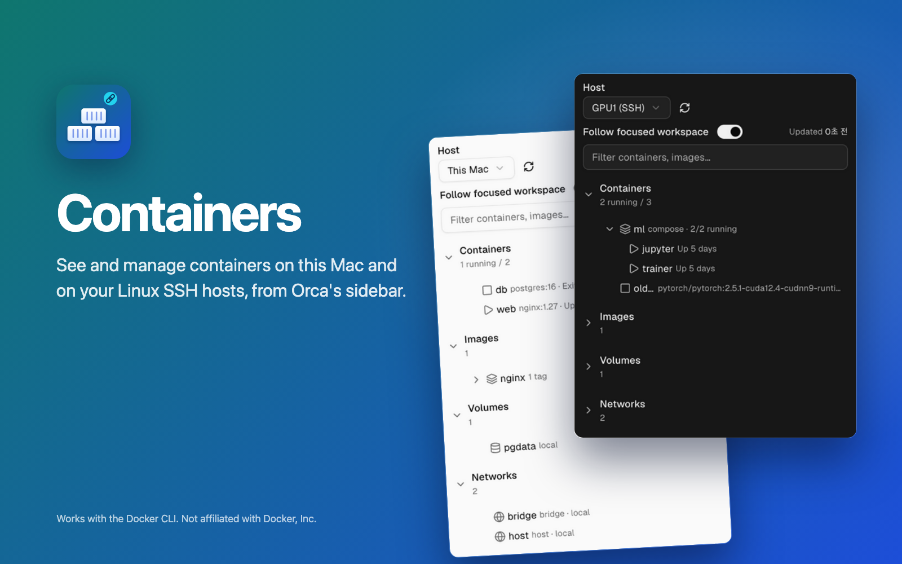

# Containers for Orca



See and manage Docker containers from an [Orca](https://github.com/stablyai/orca) sidebar panel, on
this Mac and on your Linux SSH hosts. Pick a host, see its containers, images, volumes and networks (images,
volumes and networks are listed read-only), and start, stop, restart, read logs, open a shell or
delete a container.

[한국어](README.ko.md)

## What it does

- **Host picker:** this Mac and each SSH host Orca knows.
- **Follow focused workspace:** on by default. The panel switches host only when the focused workspace
  identifies exactly one host.
- **Filter box:** every section shows only the items that contain the text you type (case does not
  matter).
- **Collapsible sections:** Containers, Images, Volumes and Networks, each with its count (Containers
  shows how many are running). Containers is open at first; the panel remembers which sections you
  opened.
- **Compose projects:** containers of the same Compose project are grouped under the project, and the
  other containers follow. Inside a Compose project a container shows a state icon, its service name and its status; other
  containers show their image and status.
- **Container details and actions:** selecting a container shows a card with its full name, image, status,
  ports, Compose project and ID, and the actions Start, Stop, Restart, Logs, Shell and Delete. Delete asks for
  confirmation and is disabled for running containers. Enter or a double-click on a container opens its
  logs. Shell opens a terminal on that host and Orca tries to bring that terminal to the front. A click on a Compose
  project row expands or collapses it.
- **Logs in the panel:** Logs shows the container's last 200 log lines under its card, without colour
  codes, and refreshes them while the panel is visible: every 3 s for this Mac, every 10 s for SSH hosts.
  Picking another container switches the logs to it. **Open in terminal** follows the logs live in an Orca
  terminal on that host, and Orca tries to bring that terminal to the front.
- **Auto refresh** only while the panel is visible: every 10 s for this Mac, every 60 s for SSH hosts.
  Change both in the plugin's Settings: `refreshLocalSeconds` (3–600) and `refreshRemoteSeconds`
  (15–3600).

## Requirements

- Orca 1.4.255 or newer, on macOS
- `docker` installed on this Mac, and on each SSH host you want to use
- SSH hosts running Linux, added through Orca's own SSH host feature
- For each SSH host, a `Host` entry in `~/.ssh/config` on this Mac with exactly the Orca host name, that
  logs in with a key and no prompt (for example a key held by ssh-agent). To check, run
  `ssh -o BatchMode=yes <host name> true` in a terminal on this Mac: it must finish without an error.
  The host name must be made of ASCII letters, digits, `.`, `_` and `-`, and start with a letter or digit; other
  names cannot be used with ssh.

## Install

In Orca, open **Settings → Plugins**, choose **Add plugin → From a Git URL…**, paste the repository
URL with a version tag and install:

```text
https://github.com/choihjin/orca-containers#v0.1.1
```

Or from a terminal: `orca plugin install choihjin/orca-containers@v0.1.1`.

Orca shows what the plugin asks for before it runs anything. Review it, then enable it.

## How it works

- **This Mac:** the plugin's worker runs the `docker` command directly.
- **Finding `docker` on this Mac:** if `docker` is not in `/usr/local/bin`, `/opt/homebrew/bin` or
  `/usr/bin`, the worker runs `/bin/zsh -lc 'command -v docker'`, which runs your zsh login startup files
  (`~/.zshenv`, `~/.zprofile`, `~/.zlogin`); a path it finds is reused, and while none is found this
  repeats on each refresh.
- **SSH hosts:** listing, actions and the logs in the panel run `ssh <host name>` from this Mac, with the
  Orca host name as the ssh destination, and send a fixed script to `sh` on that host. They open no
  terminal. ssh runs with `BatchMode=yes`, so it never asks for a password or passphrase: a host it cannot
  log in to without a prompt shows "SSH connection failed" with what to fix. An ssh run that has not
  finished after 60 seconds is stopped.
- **Terminals on SSH hosts:** only Shell and **Open in terminal** open a terminal. They use Orca's own
  command-line tool (`orca … --environment <host>`) to open an Orca terminal in a workspace on that host.

## What it asks for

| Access | Why |
| --- | --- |
| Runs its own code in a separate Node.js process with your user account's access to this machine (`trusted-worker`) | The worker has to run `docker`, `ssh` and the Orca command-line tool |
| `workspace:read` | Read the focused workspace and the list of workspaces on this Mac, and hear when the focused workspace changes (for Follow focused workspace) |
| `terminal:send` | Open the live logs (Open in terminal) and Shell terminals in a workspace on this Mac and run the fixed docker command there |
| `storage:own` | Store data in the plugin's own storage folder |
| `settings:own` | Read and change the plugin's own settings |

Running `docker`, `ssh` and the Orca command-line tool from the worker does not appear separately in Orca's
approval list. It falls under the `trusted-worker` access above. Terminals on SSH hosts (Shell and Open in
terminal) go through the Orca command-line tool.

## Limitations

- Each SSH request opens a new ssh connection, so SSH hosts answer more slowly than this Mac.
- An answer from an SSH host larger than 64 MiB is not shown; the panel says "List too long".
- The log view cuts a line after 500 characters and shows only the newest lines that fit in 15,000
  characters. Open in terminal shows them whole.
- If an SSH host's login shell startup files start tmux or screen automatically, the docker command of
  Shell or Open in terminal may be typed into that program.

## Not in v1

Planned for later, each to be verified before work starts: Compose up/down; deleting images, volumes
and networks, and pull; Orca on Linux or Windows; macOS SSH hosts; Orca older than 1.4.255; a Korean UI;
detecting SSH hosts whose login shell starts tmux or screen automatically.

## Development

```sh
pnpm install
pnpm test        # orca plugin test .
pnpm typecheck   # writes Orca's typings, then tsc
orca plugin validate .
```

The icon, cover and screenshots are HTML pages in `assets/src`. `assets/src/render.sh shots` captures the
panel from the check scenarios (Orca's window must be hidden or minimized), and `assets/src/render.sh images`
renders the PNGs with headless Chrome.

## License

[MIT](LICENSE).

This project is not affiliated with, endorsed by, or sponsored by Docker, Inc. Docker is a trademark of Docker, Inc.; the name is used only to describe compatibility.
